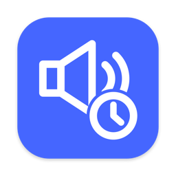
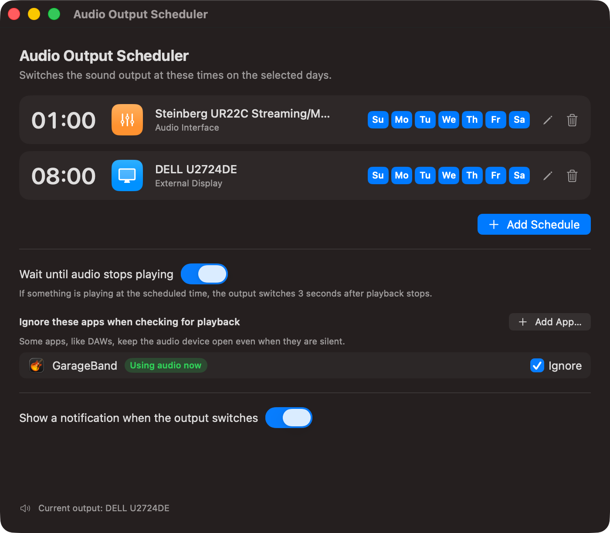

<p align="center">
  
</p>

<h1 align="center">Audio Output Scheduler</h1>

<p align="center">
  Switch your Mac's sound output automatically on a schedule —<br>
  and wait until playback stops so nothing gets cut off.
</p>

<p align="center">
  <a href="README.ja.md">日本語</a> ·
  <a href="docs/SPEC.md">Specification</a>
</p>

---



## Why

If you route audio to different devices at different times of day — an audio interface late at
night, your monitor's speakers in the morning — macOS makes you switch by hand every time.
Existing switchers react to devices being plugged in or to hotkeys; none of them follow a clock.
**Audio Output Scheduler** does exactly that, and it is careful not to yank audio away from you
in the middle of a song or a video.

## Features

- **Time-based schedules** — pick an output device and a time; add as many as you like.
- **Per-day control** — turn each schedule on or off for each day of the week
  (with *Every day / Weekdays / Weekends* shortcuts).
- **Waits for silence** — if something is playing at the scheduled time, the switch happens
  3 seconds after playback stops.
- **Ignore list** — DAWs and similar apps keep the audio device open even when silent; add them
  to the ignore list so they don't block switching. GarageBand, Logic Pro, MainStage, Cubase and
  Ableton Live are ignored by default, and you can add any app.
- **Notifications** — a banner tells you when the output switched (or why it couldn't).
- **Device-aware UI** — every device shows an icon for its kind: built-in speakers, external
  display, audio interface, virtual output, Bluetooth, AirPlay, multi-output device.
- **Spin-button time entry** — separate Hour / Minute steppers (with wrap-around) and minute presets.
- **Catches up after sleep** — if the Mac was asleep at the scheduled time, it switches on wake.
- **Native and lightweight** — SwiftUI + Core Audio, no third-party dependencies, no menu-bar
  item; a tiny background helper only runs at the scheduled times.

## Requirements

- macOS 14 Sonoma or later (developed and tested on macOS 26 Tahoe, Apple Silicon)
- Xcode Command Line Tools to build (`xcode-select --install`)

## Install

There are no prebuilt releases yet; build it from source:

```sh
git clone https://github.com/chibik1/AudioOutputScheduler.git
cd AudioOutputScheduler
./build.sh --install
open "/Applications/Audio Output Scheduler.app"
```

`./build.sh` alone builds into `./build/` without installing. The app is ad-hoc signed, which is
fine for running on your own Mac.

Open the app once after installing: it registers its background job and asks for permission to
show notifications.

## Usage

1. Click **Add Schedule**.
2. Pick an output device from the list on the left. The selected device is shown with its icon
   and kind so you can see exactly what you're scheduling.
3. Set the time with the **Hour** and **Minute** spin buttons (or the `:00 :15 :30 :45` presets).
4. Choose the days, then **Save**.

In the main window you can toggle days directly on each row, edit (pencil or double-click), or
delete a schedule. Changes take effect immediately — there is nothing to keep running.

| Setting | What it does |
| --- | --- |
| **Wait until audio stops playing** | Delays a scheduled switch while the current output is in use; switches 3 s after it goes quiet. |
| **Ignore these apps…** | Apps whose open audio stream should not count as "playing". **Add App…** lets you pick any app. |
| **Show a notification when the output switches** | Banner on every switch or failed switch. |

## How it works

The app writes your schedule to a JSON file and registers a per-user `launchd` agent that fires
at each scheduled time. At each fire, a small helper bundled inside the app works out which
schedule should be in effect, checks whether anything is playing on the current output via Core
Audio's per-process API, waits if needed, switches the default output device, and posts a
notification. See **[docs/SPEC.md](docs/SPEC.md)** for the full specification.

## Troubleshooting

**Notifications appear in Notification Center but never pop up.**
macOS suppresses banners while the display is being mirrored or shared — and virtual displays
(for example apps that turn an iPad into a monitor) can count as that. Turn on
*System Settings → Notifications → Allow notifications when mirroring or sharing the display*.
Also check that no Focus mode is active.

**A scheduled switch never happens while an app is open.**
That app is probably holding the audio device open. Look at the ignore list: apps using audio
right now are shown with a green *Using audio now* tag — tick **Ignore** for the one that should
not count. (Browsers count as playing while a tab is producing sound, which is usually what you want.)

**"Couldn't switch sound output — … is not connected".**
The target device was not available at the scheduled time; that run is skipped.

Logs are written to `/tmp/audio-switch.log`.

## Uninstall

```sh
launchctl bootout gui/$(id -u)/io.github.chibik1.audiooutputscheduler
rm ~/Library/LaunchAgents/io.github.chibik1.audiooutputscheduler.plist
rm -rf "/Applications/Audio Output Scheduler.app"
rm -rf ~/Library/Application\ Support/AudioOutputScheduler
```

## License

[MIT](LICENSE) © 2026 chibik1
